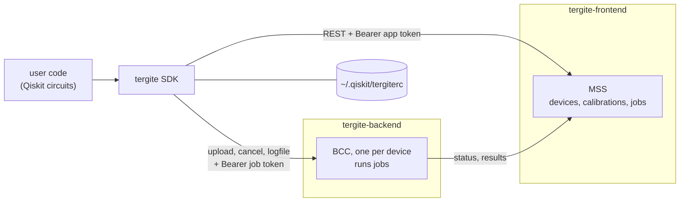

# Tergite SDK — Design

A map of the SDK for contributors: what it does, how it talks to the rest of the stack, how
its wire format is kept in step with the services, and why it is shaped as it is. How to use
it is in the [README](README.md) and [docs/](docs); how to test it and the code conventions
are in [CONTRIBUTING.md](CONTRIBUTING.md).

## What it is

`tergite` is a [Qiskit](https://www.ibm.com/quantum/qiskit) provider for the Tergite quantum
computers. A user writes circuits in Qiskit, transpiles them to a device's backend, runs them
there, and gets Qiskit's own `Result` back. It is a library on Python 3.13+, Qiskit 2.1+, httpx
and pydantic, published to PyPI.

**The SDK sends circuits; the backend compiles them.** Each backend compiles circuits to
pulses from its own calibration, so the SDK only needs what the transpiler needs: the device's
qubits, couplings, gates, and their durations and errors.

**Pulse-level programs pass through unchecked.** They are OpenQASM 3 with OpenPulse, written by
hand or with oqpy. The SDK adds the `defcal`s a job is given and offers the frames and `defcal`s
a device publishes, but it checks no pulse: the backend does, against the device's limits.

## How it fits in



| Service | What the SDK asks of it |
| --- | --- |
| MSS | the devices (`GET /devices/`), a device's latest calibration (`GET /calibrations/{name}`), a new job's id, upload URL and job token (`POST /jobs/`), a job's status and memory (`GET /jobs/{id}`) |
| BCC | upload the job file (`POST {upload_url}`), cancel it (`POST /jobs/{id}/cancel`), download its logfile (`GET {download_url}`) |

An account (service name, MSS URL, app token) is either saved in the rc file, an INI file of
`[service <name>]` sections, or taken from `TERGITE_API_URL` and `TERGITE_API_TOKEN`. The
environment account is named `env`, is never written to disk, and comes first.

## A job, end to end

```python
provider = Tergite.use_provider_account("prod", url=MSS_URL, token=APP_TOKEN)
backend = provider.get_backend("Loke")        # GET /devices/
circuit = transpile(qc, backend)              # backend.target: GET /calibrations/Loke
job = backend.run(circuit, shots=1000)        # GET /calibrations/Loke, POST /jobs/, POST upload_url
job.wait_for_final_state()                    # GET /jobs/{id}, until it is final
counts = job.result().get_counts()            # the memory, as a Qiskit Result
```

1. **`get_backend`** lists the devices from MSS on every call, so a device that comes online
   is seen. It makes a `TergiteBackend` of each, skipping with a warning any device whose shape
   the SDK cannot read.
2. **`backend.target`** comes from the device and its latest calibration
   (`tergite/backends/target.py`): `rz`, `sx`, `x` and `rx` on every qubit, `measure`, `reset`
   and `delay`, and `cz` on each coupled pair whose coupler is calibrated. Durations and errors
   come from the calibration, in SI units unless the value says otherwise.
3. **`backend.run`**:
   - accepts only circuits and OpenQASM 3 programs (text, or anything with `to_qasm()`);
   - adds the `defcal`s it is given after each program's header (`tergite/backends/pulse.py`);
   - fetches the calibration again, and recomputes the target if the device was recalibrated;
   - refuses a circuit with an instruction the target lacks;
   - registers the job at MSS, then uploads the job file to the device's BCC with the job
     token MSS returned.
4. **`job.result()`** reads the job from MSS once and returns `None` unless it is final;
   Qiskit's `wait_for_final_state()` polls until it is. For a failed or cancelled job it
   raises `JobFailedError`; otherwise it turns the memory into a Qiskit `Result`
   (`tergite/jobs/results.py`).

### The job file

```json
{"job_id": "...", "params": {
  "circuits": [{"name": "...", "qasm": "OPENQASM 3.0; ...", "num_clbits": 2, "metadata": {}}],
  "shots": 1000, "meas_level": 2, "meas_return": "single"}}
```

Each circuit is OpenQASM 3 from `qiskit.qasm3.dumps`, on the device's physical qubits. At
`meas_level` 2 the SDK always sends `meas_return: "single"`: counts need every shot.

### The memory

What MSS returns as a job's `result.memory`, one entry per circuit:

| `meas_level` | `meas_return` | Per circuit |
| --- | --- | --- |
| 2 | single | each shot's bits as hex, in clbit order, clbit 0 least significant |
| 1 | single | each shot's `[re, im]` per measured clbit |
| 1 | avg | one shot: one `[re, im]` per measured clbit |

## Code map

The packages follow what a user does: get a provider, get a backend, run a job.

```
tergite/
├── __init__.py        # the public surface: Tergite, and __all__
├── exc.py             # TergiteError and its subclasses, which users catch
├── providers/         # where a user starts
│   ├── factory.py     #   ProviderFactory: accounts by service name
│   ├── provider.py    #   Provider: an account's clients, its backends, job(job_id)
│   └── accounts.py    #   Account, over the rc file and TERGITE_API_URL/TOKEN
├── backends/          # the devices as Qiskit backends
│   ├── backend.py     #   TergiteBackend (a BackendV2)
│   ├── target.py      #   get_target: the transpiler target from a calibration
│   └── pulse.py       #   pulse-level programs, defcals, a device's frames
├── jobs/
│   ├── job.py         #   Job (a JobV1)
│   └── results.py     #   get_result: a Qiskit Result from a job's memory
├── clients/           # HTTP only; knows no Qiskit
│   ├── mss/           #   MssClient; models.py is generated
│   └── bcc/           #   BccClient; models.py is generated
└── utils/http.py      # timeouts, TLS, error answers as ApiError
```

Each package's `__init__.py` is its facade. The `Provider` owns an `MssClient`, which sends
the account's token, and a `BccClient`, which each job gives its upload URL and token. Every
call has a timeout: 30 s, or 300 s to upload a job or download a logfile. An error answer
becomes an `ApiError` naming what failed and the service's reason.

## The wire format is generated

The models of what MSS and BCC send and accept are generated from the services' OpenAPI
specs, never written by hand. The specs are pinned in `dev/openapi/mss.json` and `bcc.json`.

- `dev/openapi/sync.sh` copies the specs from tergite-frontend and tergite-backend checkouts.
- `uv run python -m dev.openapi.generate` prunes each spec to what the SDK uses, makes it
  lenient where the SDK must not break (read-only fields optional, string patterns dropped),
  and generates `models.py` with datamodel-code-generator.
- `tests/test_openapi.py` fails if the models differ from what the pinned specs generate.
- The e2e runs `dev/openapi/check_served.py` against the live MSS and BCC, and fails if what
  they serve breaks the pinned specs: a field the SDK reads dropped or retyped, a field it
  does not send now required, an enum changed. New optional fields pass.

So a change to a service's models reaches the SDK as a reviewable diff to a pinned spec.

## Decisions

Each was a choice between alternatives, made when the SDK moved to Qiskit 2.

- **The SDK sends circuits, not pulses.** Qiskit 2 has no `qiskit.pulse`. Rather than compile
  gates to pulses itself or vendor old Qiskit, the SDK sends OpenQASM 3 and the backend, which
  has the calibration, compiles it. `OpenPulseBackend` and `OpenQASMBackend` became deprecated
  names of `TergiteBackend`.
- **Pulses are OpenQASM 3 with OpenPulse**, in the same job file: `defcal`s replace a gate's
  pulses, `cal` blocks play on the device's frames. Only projects an admin allowed may send
  them, and the backend refuses what exceeds its limits.
- **One wire format, released together.** The SDK sends only OpenQASM 3, and the backend of
  the same release takes only that. An older SDK stops working when its backend upgrades;
  with few users, that cost less than keeping a second format.
- **`get_provider(name)` raises for an unknown name** instead of returning the first saved
  account, so a typo cannot send jobs to another service.
- **`Provider.job(job_id)` rebuilds a result from MSS**, which keeps a job's shots,
  measurement level, circuit names and classical bits. The SDK keeps no payload and downloads
  no logfile to read them back.

## Known rough edges

- **`provider.job(job_id)` cannot rebuild register names.** MSS keeps the circuits' classical
  bits but not their registers, so a job fetched by id has counts keyed by bits. For a job an
  older backend ran, the shots and measurement level are read from its memory.
