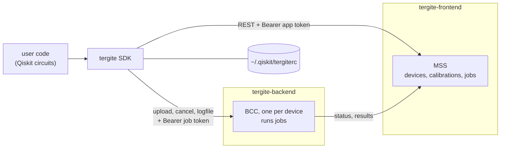

# Tergite SDK — Design

This document describes the architecture of `tergite`, the Python SDK of the
[Tergite stack](https://tergite.github.io/): what it does for a user, how it talks to the
rest of the stack, how its wire contract is kept in step with the services, how it is tested
and released, and the conventions a contributor is expected to follow. How to use it is in
the [README](README.md); how to contribute is in [CONTRIBUTING.md](CONTRIBUTING.md).

## 1. What this repo is

`tergite` is a [Qiskit](https://www.ibm.com/quantum/qiskit) provider for the Tergite quantum
computers: a user writes circuits in Qiskit, transpiles them to a device's backend and runs
them there, and gets Qiskit's own `Result` back. It is a library, Python 3.13+, on Qiskit 2.1+,
httpx and pydantic, published to PyPI.

The SDK sends circuits, and pulse-level programs it does not compile. Each backend compiles
circuits to pulses from its own calibration, so the SDK needs only what the transpiler needs: a
device's qubits, couplings, gates and their durations and errors. Pulse-level programs are
OpenQASM 3 with OpenPulse, which users write by hand or with oqpy (the `pulse` extra); the SDK
adds the `defcal`s a job is given, and offers the frames and `defcal`s a device publishes with
its calibration, but checks no pulse: the backend does, against the device's limits.

## 2. System context



| Service | What the SDK asks of it |
| --- | --- |
| MSS | the devices (`GET /devices/`), a device's latest calibration (`GET /calibrations/{name}`), a new job's id, upload URL and job token (`POST /jobs/`), a job's status and memory (`GET /jobs/{id}`) |
| BCC | the job file (`POST {upload_url}`), cancelling (`POST /jobs/{id}/cancel`), the job's logfile (`GET {download_url}`) |

An account (a service name, MSS's URL, an app token) can be saved in the rc file, an INI file
of `[service <name>]` sections.

## 3. A job, end to end

```python
provider = Tergite.use_provider_account("prod", url=MSS_URL, token=APP_TOKEN)
backend = provider.get_backend("Loke")        # GET /devices/
circuit = transpile(qc, backend)              # backend.target: GET /calibrations/Loke
job = backend.run(circuit, shots=1000)        # GET /calibrations/Loke, POST /jobs/, POST upload_url
counts = job.result().get_counts()            # GET /jobs/{id}, until it is final
```

1. **`get_backend`** lists the devices from MSS on each call, so a device coming online is
   seen, and makes a `TergiteBackend` of each; a device MSS sends in a shape the SDK cannot
   read is skipped with a warning.
2. **`backend.target`** is computed from the device and its latest calibration by
   [target.py](tergite/target.py): `rz`, `sx`, `x` and `rx` on every qubit, `measure`, `reset`
   and `delay`, and `cz` on each coupled pair whose coupler is calibrated. Durations and errors
   come from the calibration, in SI units unless the value's unit says otherwise.
3. **`backend.run`** refuses anything but circuits and OpenQASM 3 programs (text, or anything
   with `to_qasm()`, an oqpy Program's externs put in a `cal` block), adds the `defcal`s it is
   given after each one's header ([pulse.py](tergite/pulse.py)), fetches the calibration again and recomputes
   the target if the device was recalibrated, refuses a circuit with an instruction the target
   lacks, registers the job at MSS with the calibration's date, and uploads the job file to
   the device's BCC with the job token MSS gave.
4. **`job.result()`** reads the job from MSS until it is final, raises `JobFailedError` for a
   failed or cancelled job, and turns its memory into a Qiskit `Result`
   ([results.py](tergite/results.py)).

### The job file

```json
{"job_id": "...", "params": {
  "circuits": [{"name": "...", "qasm": "OPENQASM 3.0; ...", "num_clbits": 2, "metadata": {}}],
  "shots": 1000, "meas_level": 2, "meas_return": "single"}}
```

Each circuit is OpenQASM 3, from `qiskit.qasm3.dumps`, its qubits the device's physical qubits.
At `meas_level` 2 the SDK always sends `meas_return: "single"`, as Qiskit defines
`meas_return` only for levels 0 and 1, and counts need every shot.

### The memory

What MSS returns as a job's `result.memory`, one entry per circuit:

| `meas_level` | `meas_return` | Per circuit |
| --- | --- | --- |
| 2 | single | each shot's bits as hex, in clbit order, clbit 0 least significant |
| 1 | single | each shot's `[re, im]` per measured clbit |
| 1 | avg | one shot: one `[re, im]` per measured clbit |

## 4. Package layout

| Path | What it holds |
| --- | --- |
| `tergite/__init__.py` | the public surface, `__all__`, and `Tergite`, the default `ProviderFactory` |
| `tergite/types/provider_factory.py` | `ProviderFactory`: accounts by service name, the rc file read on first use |
| `tergite/types/provider.py` | `Provider`: an account's HTTP clients, its backends, `job(job_id)` |
| `tergite/accounts.py` | `Account`, and `load_accounts` and `save_account` over the rc file |
| `tergite/backend.py` | `TergiteBackend`, a Qiskit `BackendV2`; `OpenPulseBackend` and `OpenQASMBackend` are its deprecated names |
| `tergite/target.py` | `get_target`: a device's transpiler target from its calibration |
| `tergite/pulse.py` | pulse-level programs' OpenQASM 3 and classical registers, the `defcal`s a job is given, and a device's frames and `defcal`s from its calibration |
| `tergite/job.py` | `Job`, a Qiskit `JobV1` |
| `tergite/results.py` | `get_result`: a Qiskit `Result` from a job's memory |
| `tergite/api/` | the calls to MSS (`mss.py`) and BCC (`bcc.py`), the HTTP clients (`client.py`), the job file (`job_file.py`) and the generated wire models |
| `tergite/exc.py` | `TergiteError` and its subclasses: `ApiError`, `BackendNotFoundError`, `JobFailedError`, `UncalibratedCouplerError` |

The `Provider` owns two httpx clients, one for MSS, which reads the account's token on each
request, and one for the BCCs, which carries each job's token per call. Every call has a
timeout: 30 s, or 300 s to upload a job or download a logfile. An error answer becomes an
`ApiError` naming what failed and the service's detail.

## 5. The wire contract, from OpenAPI

The models of what MSS and BCC send and accept are generated, never written by hand:
`tergite/api/mss_models.py` and `bcc_models.py` come from the services' OpenAPI specs, pinned
in `dev/openapi/mss.json` and `bcc.json`.

- `dev/openapi/sync.sh` takes the specs from tergite-frontend and tergite-backend checkouts;
  `uv run python -m dev.openapi.generate` prunes each spec to the schemas the SDK uses, makes
  it lenient where the SDK must not break (read-only fields not required, string patterns
  dropped), and generates the models with datamodel-code-generator.
- `tests/test_openapi.py` fails when the models are not what the pinned specs generate.
- The e2e runs `dev/openapi/check_served.py` against the MSS and BCC it starts, and stops
  when what they serve differs from the pinned specs, naming the schemas.

So a change to a service's DTOs reaches the SDK as a diff to a pinned spec, in review.

## 6. Testing

| Level | Where | Command |
| --- | --- | --- |
| Unit and integration | `tests/`, with MSS and BCC mocked by respx | `uv run pytest` |
| e2e | `tests/e2e`, through [dev/e2e_native_test.sh](dev/e2e_native_test.sh), against real MSS and backends | `FRONTEND_PATH=../tergite-frontend BACKEND_PATH=../tergite-backend ./dev/e2e_native_test.sh` |
| Performance | `dev/perf`, the client against mocks and the round trip against the e2e stack | `./dev/perf/record.sh /tmp/perf && uv run python dev/perf/compare.py dev/perf/baselines /tmp/perf` |

- **Unit and integration.** `tests/integration/conftest.py` mocks MSS and a BCC with respx,
  from the JSON in `tests/fixtures/`; respx routes match in the order they are added, and the
  same pattern is the same route, so a test changes an answer by re-routing that pattern or by
  monkeypatching the fixture data a handler reads. Shared helpers live in `tests/utils/`, by
  what they do. Pytest turns a `DeprecationWarning` into an error.
- **e2e.** The script runs MongoDB, MSS and the backends from checkouts, natively, all from
  fresh data in `temp-native/`: MSS's config, keys and seed from tergite-frontend's
  `ui/fixtures`; the simulators, `sim_1q` and `sim_2q`, a simulated chip behind dummy clusters,
  from tergite-backend's `tests/fixtures` as its packages ship them, waiting for the
  recalibration each starts with; Loke, a two-qubit dummy device on the quantify executor,
  from this repo's own configs. With `IS_END_TO_END=true` pytest collects `tests/e2e` instead
  of `tests/integration`.
- **Performance.** `compare.py` fails a measure more than 10% and its noise floor worse than
  its baseline, or one more HTTP call. Compare runs made on the same machine; a change that
  moves a measure on purpose records new baselines in the same commit, saying why.
- **Style.** [tests/test_styleguide.py](tests/test_styleguide.py) checks what black, isort and
  pyflakes cannot (§8). What the code broke when it was added is listed in
  `tests/fixtures/styleguide_baseline.txt`, which only shrinks: a fix that is not deleted
  from it fails the test.

## 7. CI and releases

GitLab CI ([.gitlab-ci.yml](.gitlab-ci.yml)) is the source of truth; GitHub Actions
([.github/workflows](.github/workflows)) mirrors it.

- `test`, on merge requests and `v*` tags: with uv from `uv.lock` on Python 3.13,
  `black --check`, `isort --check-only` and `pyflakes` over `tergite tests dev`, then `pytest`.
- `e2e`, on merge requests, `main` and `v*` tags: `dev/e2e_native_test.sh` after installing
  MongoDB, against the tergite-frontend and tergite-backend branches of the same name, else
  their `main`.
- On a `v*` tag, `deploy staging` and `deploy production` build with `uv build` and publish
  to Test PyPI and PyPI, where `SHOULD_PUBLISH_TO_STAGING` or `SHOULD_PUBLISH_TO_PROD` is set.

Versions are `{year}.{month}.{patch}`, e.g. `2026.06.0`, released with the rest of the stack.
A release sets `version` in `pyproject.toml`, runs `uv lock`, and dates the `[Unreleased]`
section of [CHANGELOG.md](CHANGELOG.md). A release candidate is `{version}-rc.{n}`, the first
of a version `rc.0`; its tag is signed, `v` before the version.

## 8. Working on this repo

### Version control

Tergite is developed on a private GitLab and mirrored to GitHub, whose pull requests and
issues are not read. Contributions and bug reports go to
<contact.quantum@chalmersnextlabs.se>; code changes need a signed CLA. See
[CONTRIBUTING.md](CONTRIBUTING.md).

### Changelog entries and commits

A changelog entry is one or two sentences: what changed, and what a user would have hit
before, under `[Unreleased]`, in `Added`, `Changed` or `Fixed`. The reasoning, alternatives
and numbers go in the commit body. One logical change per commit, decided before editing.
Never add assistant attribution to commit messages or merge request bodies.

### Style guide

The same as tergite-frontend's:

- **Comments and docstrings earn their place**: the constraint, the gotcha, the why the code
  cannot say; never a restatement of the code or the history of a fix. Docstrings are Google
  style (`Args:`, `Returns:`, `Raises:` with the messages callers can expect) and say what a
  function does for its caller.
- **Names**: variables are nouns, functions are verbs, booleans start with `is_` or
  `should_`.
- **No banner comments** at any indent. A group that needs a label needs a docstring or a
  file of its own.
- **Tests**: the name says what it tests; a comment only where the why is not obvious.
- **The licence header** on every file, with a line per contributing party.
- **`black` and `isort`** (profile black) format, and `pyflakes` finds unused names; CI fails
  on any of the three.

`tests/test_styleguide.py` enforces the names, the layout below, banner comments, licence
headers, type hints and the public surface's `__all__`.

### Code structure

Code reads like an article: the overview first, the detail below it. New code follows these
rules, and code a change touches is brought in line with them.

1. **A function is a composition of functions.** A public function's body is a short sequence
   of calls, each to a function that does one thing and is named for it, and each step is
   built the same way until it is a single operation.
2. **Two exceptions.** Do not extract a step that would be a one-line function. Do not split a
   performance-critical path where the extra calls cost something measurable.
3. **Callees sit below their callers.** A file runs: constants, public functions in the order
   a caller uses them, then private helpers in the order they are first called.
4. **A comment that labels a phase is a missing function**, named for what the phase does.
5. **Data is a struct; state gets a class.** Data is a pydantic model, a `@dataclass`,
   an `Enum` or an `Exception`; its only methods are derived views of its own fields and
   `from_*`/`to_*` conversions. What owns state across calls (the HTTP clients, a backend's
   target, a job's last-known status) is a class. Qiskit's base classes are the one place the
   SDK inherits: `TergiteBackend(BackendV2)` and `Job(JobV1)` are the contract users program
   against.
6. **Stateless behaviour is a module-level function**, taking explicit arguments and returning
   data, the HTTP client first when it does I/O: `get_target`, `get_result`, `mss.create_job`.
   No `Protocol` or ABC with one implementation, no inheritance to share behaviour.
7. **Dependencies arrive as arguments.** Importing `tergite` does no I/O and prints nothing.
   The `Provider` owns its HTTP clients and hands them to the functions that call the API; only
   `accounts.py` reads the rc file, when asked to.
8. **One home per kind of thing.** HTTP lives in `tergite/api/`. Errors subclass
   `tergite.exc.TergiteError`. The public surface is `tergite/__init__.py`, with `__all__`.
   Development and test tooling (the OpenAPI generator, the e2e runner, the performance
   checks) lives in `dev/`.
9. **A reputable library beats our own code, and nothing is vendored.** When Qiskit removes
   something, the SDK stops needing it rather than copying it. The commit that adds our own
   code says why no library did the job.
10. **A name says what the thing is.** No function is named `build_*`: a constructed thing is
    a class's constructor, and anything else is got, so the function is a `get_*`.
11. **Obvious beats clever.** An `if`/`else` returning each whole literal, one explicit `if`
    per optional field; not loops over tuples of fields or helpers returning two things to
    pull apart.
12. **The wire is generated, not transcribed** (§5), so a change on either side fails a test
    here, not a user's job.
13. **A value that is only defined stays where it is used.** No function that only returns a
    literal.
14. **The public API holds.** `Tergite.use_provider_account`, `Tergite.get_provider`,
    `provider.backends`, `provider.get_backend`, `provider.job`, `backend.run`,
    `backend.target`, `backend.set_options`, `job.status`, `job.result`, `job.cancel`,
    `job.download_url` and `job.logfile` keep their signatures. A break comes with a `Changed`
    changelog entry and, where it can, a deprecation warning for one release.

Every commit is checked the same way: `black` and `isort`, `pyflakes tergite tests dev`, then
`pytest`. A change to how the SDK talks to MSS or BCC also passes `dev/e2e_native_test.sh`,
and a change that may cost time or memory, `dev/perf/record.sh` and `compare.py`.

### Slow commands

Redirect a test suite, the e2e or a perf run to one log file per kind of run, and read that
file for follow-up questions instead of running it again:

```bash
uv run pytest > "$LOG" 2>&1; echo "exit=$?" >> "$LOG"
```

A pipe reports its last command's status, so `pytest | tail` makes a failing suite read as
green.

### Python style

On top of the [style guide](#style-guide) and the [code structure](#code-structure):

- **`black` is authoritative** for formatting, and `isort` sorts imports with
  `profile = "black"`, so the two agree; neither takes flags.
- **Constants go at the top of the file**, after the imports. The exception is a constant
  built from a function or class of the same file, which stays after it.
- **Data classes are frozen** where nothing mutates them.
- **Type hints everywhere**, return types included; what crosses a module is a model, never
  a bare dict.
- **Docstrings**: one line where one line does; `Args:`, `Returns:` and `Raises:` where a
  function takes several arguments or raises what its caller handles.
- **Tests**: shared helpers and fixtures in `tests/utils/`, grouped by what they do; the
  baseline of `tests/test_styleguide.py` only shrinks.

### Adding things to the SDK — where to start

| Task | Path |
| --- | --- |
| A call to MSS or BCC | a module-level function in `tergite/api/mss.py` or `bcc.py`, the client first; a respx route in `tests/integration/conftest.py` |
| A field MSS or BCC sends | `dev/openapi/sync.sh` against their checkouts, then `python -m dev.openapi.generate`; the diff to the pinned spec is the review |
| A gate the transpiler may use | `tergite/target.py`, from the calibration; a case in `tests/test_target.py` |
| A public name | `tergite/__init__.py` and its `__all__`; its signature in `tests/integration/test_public_api.py` |
| An error a user catches | a subclass of `TergiteError` in `tergite/exc.py` |
| A test against the real stack | `tests/e2e/`, run by `dev/e2e_native_test.sh` |
| A measure of speed or calls | `dev/perf/`, and new baselines in the same commit, saying why |

## 9. Decisions

Why the SDK is shaped as it is; each was a choice between alternatives, made in the refactor
that brought it to Qiskit 2.

- **The SDK sends circuits, not pulses.** Qiskit 2 has no `qiskit.pulse`, so the SDK no longer
  compiles gates to pulses from the calibration, nor vendors Qiskit to keep a `PulseQobj`: the
  backend, which has the calibration, compiles OpenQASM 3. `OpenPulseBackend` and
  `OpenQASMBackend` are one `TergiteBackend`, their names deprecated aliases.
- **Pulse level is OpenQASM 3 with OpenPulse**, in the same job file: `defcal` blocks replace
  a gate's pulses within a job, `cal` blocks play on the frames a device publishes. The SDK
  writes no pulses and checks none: users write them with oqpy or by hand; only a project an
  admin allowed may send them, and the backend refuses what is beyond its device's limits.
- **One wire format, released together.** The SDK sends only OpenQASM 3 and the backend of
  the same release takes only it: an older SDK stops working the day its backend upgrades,
  which cost less, with few users, than keeping a second payload and the code behind it.
- **`get_provider(name)` raises for an unknown name**, rather than returning the first saved
  account, so a typo cannot send jobs to another service.
- **`Provider.job(job_id)` rebuilds a result from MSS**, which keeps a job's shots,
  measurement level and circuits' names and classical bits, so the SDK keeps no payload and
  downloads no logfile to read them back.

## 10. Known rough edges

- **`provider.job(job_id)` cannot rebuild register names.** MSS keeps how a job ran and its
  circuits' names and classical bits, but not their registers, so a job got by its id has
  counts keyed by bits; of a job an older backend ran, the shots and measurement level are
  read from its memory.
